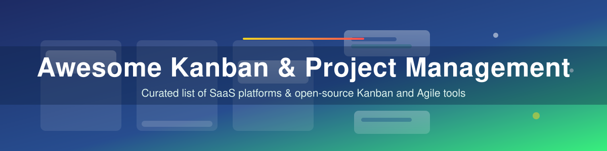

  

<!-- Badges: left side of the badge list -->

<!-- Badge: right side of the badge list -->

# Awesome Kanban & Project Management 🚀

> 📋 **Kanban project management software comparison** — the best **SaaS Kanban and project management platforms** and **open-source Kanban tools** for teams in 2026.
> A curated, regularly-updated awesome list covering **visual workflow management**, **Agile boards**, **Kanban boards**, **self-hosted alternatives to Trello & Jira**, and **team collaboration**.

**Last updated: October 2026** 🗓️

## Table of Contents

- [Sector Overview & Market Dynamics](#-sector-overview--market-dynamics)
- [SaaS/Hosted Platforms](#-saashosted-platforms)
- [Open-Source GitHub Projects](#-open-source-github-projects)
- [Choosing the Right Tool](#%EF%B8%8F-choosing-the-right-tool)
- [How to Contribute](#-how-to-contribute)
- [Support the Project](#%EF%B8%8F-support-the-project)
- [Star History](#-star-history)
- [Disclaimer](#-disclaimer)

## 📊 Sector Overview & Market Dynamics

The **project management software market** is estimated at **~$8–9 billion in 2026** and projected to more than double to **~$15–20 billion by 2030** (roughly 11–13% CAGR), fueled by remote work,visual workflow adoption and AI-assisted planning. The sector is **moderately concentrated, not winner-take-all**: Atlassian (Jira + Trello), monday.com, Asana and ClickUp capture the bulk of enterprise spend, but a **highly fragmented long tail** of niche SaaS players (KanbanFlow, MeisterTask, Businessmap…) and a vibrant open-source ecosystem (Focalboard, Wekan, OpenProject, Planka) keeps alternatives alive — especially for self-hosting and privacy-focused teams.

## 💼 SaaS/Hosted Platforms

*Sorted by estimated company size (revenue/valuation), descending.* 💰

| Rank | Tool | 🏢 Company Size (Revenue / Valuation) | 💵 Pricing (starting paid tier) | 🆓 Free Tier / Free Trial Limits |
|------|------|--------------------------------------|--------------------------------|----------------------------------|
| 1 | **[Jira Software](https://www.atlassian.com/software/jira)** | 💼 **$6.57B** revenue (Atlassian, FY2026) | Standard **$8.48/user/mo** | Free forever: **10 users**, **2 GB storage**, unlimited projects & work items, 100 automation runs/mo |
| 2 | **[Trello](https://trello.com/)** | 💼 Part of Atlassian (**$6.57B** FY2026 revenue; acquired for **$425M** in 2017) | Standard **$5/user/mo** billed annually ($6 monthly) | Free forever: **10 boards & 10 collaborators** per Workspace, unlimited cards, unlimited storage at **10 MB/file**, 250 command runs/mo |
| 3 | **[Monday.com](https://monday.com/)** | 💼 **$1.23B** revenue (FY2025) | Basic **$9/seat/mo** billed annually | Free forever: **2 seats, 3 boards, 3 Docs**, 200+ templates |
| 4 | **[Asana](https://asana.com/)** | 💼 **$790.8M** revenue (FY2026) | Starter **$10.99/user/mo** billed annually ($13.49 monthly) | Free forever (Personal): **2 users**, unlimited tasks & projects, list/board/calendar views, 100 MB/file storage |
| 5 | **[ClickUp](https://clickup.com/)** | 💼 **$300M+ ARR** (2025); **$4B** valuation (2021 Series C) | Unlimited **$7/user/mo** billed yearly ($10 monthly) | Free Forever: unlimited members, tasks & projects; **60 MB** workspace storage |
| 6 | **[MeisterTask](https://www.meistertask.com/)** | 💼 **~$34M** est. revenue (2024) | Pro **$7/user/mo** | Free forever: **3 projects**, unlimited team members & tasks, 5 notes, 20 MB/file |
| 7 | **[SwiftKanban (NimbleWork)](https://www.digite.com/kanban/)** | 💼 **~$10M** est. revenue (2024, Digité) | Group **$7/user/mo** paid annually | Free Team plan: **3 users, 2 boards**, 5 standard + 5 custom card types |
| 8 | **[Kanbanize (Businessmap)](https://kanbanize.com/)** | 💼 **~$4.2M** est. revenue (2025) | Standard **$149/mo** billed annually for up to **15 users** (≈$9.93/user/mo) | ❌ No free plan — **30-day full-feature free trial**, no credit card required |
| 9 | **[KanbanFlow](https://kanbanflow.com/)** | 💼 Small private company (CodeKick AB) — figures undisclosed | Premium **$5/user/mo** ($4.50 with 10% yearly discount) | Free forever, no time limit: **unlimited boards & tasks** (tests & Premium features excluded) |
| 10 | **[Kanbanchi](https://www.kanbanchi.com/)** | 💼 Small private company (UK) — figures undisclosed | Essential **$5.99/mo** ($3.97/mo billed yearly) | Free plan (no time limit): **36 cards per board** — boards above the limit become read-only |

## 🛠️ Open-Source GitHub Projects

*Sorted by GitHub ⭐ Stars_Count, descending. Click the badge next to each project to view its stargazers page.*

| Rank | Repository | ⭐ GitHub_Stars | 📄 Description |
|------|------------|----------|----------------|
| 1 | [**Focalboard**](https://github.com/mattermost-community/focalboard) &nbsp; | 26,509 | Self-hosted, multilingual alternative to Trello/Notion/Asana. Kanban, table, gallery & calendar views. Standalone app currently unmaintained — the Mattermost Boards plugin version remains active. |
| 2 | [**Wekan**](https://github.com/wekan/wekan) &nbsp; | 21,121 | The most mature open-source Trello alternative. Board templates, comments, attachments, checklists, custom fields, access controls. Node.js + MongoDB. |
| 3 | [**OpenProject**](https://github.com/opf/openproject) &nbsp; | 16,442 | Full-featured project management: Kanban boards, Gantt, timelines, milestones, dependencies, agile planning. The closest open-source equivalent to Jira/Asana. GPLv3. |
| 4 | [**Planka**](https://github.com/plankanban/planka) &nbsp; | 12,618 | Elegant real-time Kanban for workgroups — React + Redux, labels, members, time tracking, attachments, Markdown, 35+ languages, OpenID Connect SSO. AGPL-3.0. |
| 5 | [**Leantime**](https://github.com/Leantime/leantime) &nbsp; | 11,840 | Accessibility-first project management suite: Kanban, Gantt, sprints, milestones, idea & research boards. Great for ADHD-friendly/non-techy teams. |
| 6 | [**Kanboard**](https://github.com/kanboard/kanboard) &nbsp; | 9,907 | Minimalist Kanban that runs anywhere — PHP + SQLite, MIT. Automatic actions, subtasks, lead/cycle-time analytics, webhooks, API, plugin ecosystem. (Maintenance mode) |
| 7 | [**Kan (kanbn)**](https://github.com/kanbn/kan) &nbsp; | 5,773 | Open-source Trello alternative with board visibility, workspace collaboration, and one-click Trello import. |
| 8 | [**Vikunja**](https://github.com/go-vikunja/vikunja) &nbsp; | 5,770 | "The task manager you actually own." Go + Vue: Kanban, Gantt, table, list & calendar views, automations, API, webhooks, WebDAV. GPLv3. |
| 9 | [**Worklenz**](https://github.com/Worklenz/worklenz) &nbsp; | 3,245 | Free project management with an extended Kanban board, Gantt and resource planning. Node.js + PostgreSQL. Self-hosted or managed (~$6/user/mo). AGPL-3.0. |
| 10 | [**Restya Board**](https://github.com/RestyaPlatform/board) &nbsp; | 2,089 | Trello-like self-hostable board with tasks, checklists, and activity feeds. |
| 11 | [**Nextcloud Deck**](https://github.com/nextcloud/deck) &nbsp; | 1,428 | Kanban app baked into your self-hosted Nextcloud: cards linked to files, assignments, comments, activity streams. Ideal for privacy-focused organizations. |
| 13 | [**Taiga**](https://github.com/taigaio/taiga-back) &nbsp; | 857 | Agile project management for Scrum + Kanban teams: backlogs, sprints, epics, issue tracking. Self-hosted core is free (AGPL). |
| 14 | [**4ga Boards**](https://github.com/RARgames/4gaBoards) &nbsp; | 728 | Real-time self-hosted boards with Markdown support, import/export, and multi-level project/board/list/card structure. |
| 14 | [**Kanba**](https://github.com/Kanba-co/kanba) &nbsp; | 660 | Open-source project management for modern teams. |
| 15 | [**Personal Kanban**](https://github.com/nishantpainter/personal-kanban) &nbsp; | 556 | Agile personal board with WIP limits, columns, and start/end points. Single-page HTML/JS, works offline. |
| 16 | [**Flowforge**](https://github.com/Relaticle/flowforge) &nbsp; | 422 | Laravel Kanban boards with drag-and-drop ordering for Filament and Livewire applications. |
| 17 | [**Wuffle**](https://github.com/nikku/wuffle) &nbsp; | 133 | Multi-repository / multi-organization task board for GitHub issues. |
| 18 | [**Iguana**](https://github.com/iguana-project/iguana) &nbsp; | 126 | Open-source issue management system with a Kanban board, backlog, and time logging. |
| 19 | [**Joindesk**](https://github.com/joindesk/Joindesk) &nbsp; | 82 | Open-source project management with Kanban, calendar, and Gantt views. |
| 20 | [**Werkyn**](https://github.com/rackstead/werkyn) &nbsp; | 42 | Open-source project management & collaboration: Kanban boards, list/calendar views, wiki, files, command palette. (Development preview) |

## ✅ Choosing the Right Tool

🧭 **SaaS**: Choose **Jira** for enterprise software teams, **Trello** for simplicity, **monday.com/Asana/ClickUp** for cross-functional work management.

🧭 **Open-source**: Choose **Wekan** for the closest Trello clone, **Planka** for the best modern UI with real-time sync, **Kanboard** for minimal resource usage and automation, **Vikunja** or **Kan** for multiple views, **Leantime** for accessible planning, and **Nextcloud Deck** if Nextcloud is already your backbone. For agile/Scrum teams, **Taiga** (AGPL) integrates Scrum + Kanban.

## 🤝 How to Contribute

1. 🍴 Fork the repo.
2. ✏️ Add/edit entries in `README.md` (follow existing format).
3. 📦 Include: name, link, 1–2 sentence description, and whether it's SaaS or open-source.
4. 🚀 Submit PR with a short explanation.

⭐ Star the repo if you find it useful!

## 💖 Support the Project

Thank you for checking out this repository! 🙏 If it saved you time or helped you pick the right tool:

- ⭐ **Star** the repo so others can discover it
- 🍴 **Fork** it and add your own entries via PR
- 🔗 **Share** it with your team or on social media
- ☕ **Buy me a coffee** via the [Sponsor Dashboard](https://github.com/sponsors/ishandutta2007)

Your support keeps this list maintained and growing!

## 📈 Star History

## ⚠️ Disclaimer

- This is a **community-curated** list — not exhaustive and not an endorsement.
- **License awareness**: Planka, Taiga, Worklenz & Restya Board are AGPL-3.0/AGPLv3; Wekan, Kanboard, Flowforge are MIT/Apache-family; Focalboard is Apache 2.0 (standalone repo unmaintained); Vikunja is GPLv3; OpenProject & Leantime are GPLv3-family. Verify terms before commercial deployment.
- Self-hosted solutions require server infrastructure, backup strategy, and regular security updates.
- Pricing and company-size figures reflect each vendor's latest published pages/reports (or third-party estimates, marked "est.") as of **October 2026**; they change frequently — always confirm on the official pricing page.
- Revenue/valuation entries are **not financial advice** and may include third-party estimates from sources like GetLatka or Sacra.

---

**Made for agile teams, project managers, self-hosting enthusiasts, and privacy-conscious organizations.** 🧩
Let's make Kanban project management more open, self-hosted, and vendor-neutral. 🌍
